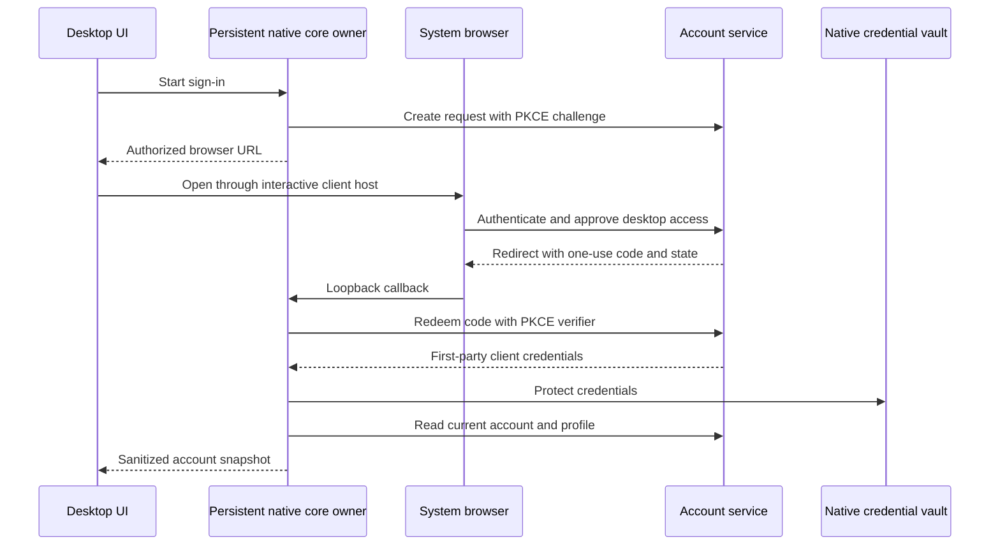

# Native account sign-in and user profile integration

Status: native sign-in/profile, account observation, admission controls, session management and
service-authorized account disablement implemented. Hosted deployment and remaining platform/provider
qualification are pending. Saved-account switching, device-code login and account-linked enrollment
remain proposed capabilities; they are not part of the implemented native contract.
Accepted clarification: credential ownership, renewal and revalidation belong to the native core
and a persistent headless owner. They must not depend on the desktop window or client launcher.

## Implemented initial path

The first integration now includes the persistent per-user account owner, platform vault adapters,
CLI/native gateway forwarding, optional browser-native PKCE sign-in, independent rotating grants,
local/hosted logout and app-owned names and avatars. The scoped extension adds the identity/avatar
rail menu, Profile and Account security in full Settings, and owner-backed account observation across
open clients. Production-preparation deliveries add shared admission/retention controls, native session
listing and revocation, and service-authorized account disablement. See [native grants](native-accounts.md),
[session policy](native-account-sessions.md) and
[native client ownership](../client-runtime/docs/accounts.md) for the implemented operations and
limits. The phases below retain follow-up scope; their presence does not imply each phase is complete.
The broader account portal, saved accounts, device-code entry and account-linked
node/hosted authorization remain pending. Production deployment and account policy are not part of
this initial development integration.

## Product behavior

The application opens directly into local work. Sign-in is optional and unlocks explicitly
authorized hosted capabilities. Local nodes, SSH connections, projects and Harness sessions
remain usable without a hosted account. Signing in does not upload or claim those resources.

An account control at the bottom of the navigation rail displays the current identity, or a
sign-in action when signed out. Its menu provides Profile, Settings, account security and Sign out.
The avatar falls back to a user icon when absent or unavailable. Settings remain available without
an account. Account security describes installation-scoped credential storage and sign-out, including
the independent browser session. Profile initially shows a display name, avatar,
verified email and session status. Name and avatar are editable; email belongs to the verified
identity workflow and cannot be changed through the profile form.

Account sign-in opens the system browser. The desktop displays progress, cancellation, a way
to reopen the browser and a meaningful failure state. Browser completion is followed by native
credential storage and an authenticated account read before the application reports success.
The owner retains the authorized browser URL in its sanitized pending-login snapshot so reopening
Settings can reopen the existing attempt. Closing the view does not cancel the attempt; stopping
the owner ends an incomplete memory-only attempt.

Account identity, display profile, collaboration membership and Harness authentication have
separate lifecycles. Authentication for a Harness remains under its adapter and execution owner.
An application account change does not silently change the account used by a Harness.
Collaboration Workspaces remain a later premium capability; sign-up does not create a Workspace.

## Responsibility boundaries

| Repository and component | Responsibility |
| --- | --- |
| Public native core | Account authority, credential vault, sign-in attempts, callback validation, renewal, revalidation and hosted request authentication |
| Persistent native runtime/host | Own the account manager independently of UI processes; serve account operations to desktop and CLI consumers |
| Public native client gateway | Forward account intent and subscribe to sanitized core snapshots without owning account credentials or renewal |
| Public desktop presentation | Account menu, progress, profile editor and error recovery through typed native operations |
| Public contracts | Sanitized account snapshots and operation declarations, independent of a private implementation |
| Private account service | Browser authentication, desktop authorization codes, first-party client sessions, revocation and profile persistence |
| Private account browser surface | Account-only sign-in, recovery, verification, passkeys and explicit desktop handoff |
| Private documentation repository | Decisions, operation contracts, delivery plan and acceptance criteria |

The account manager is a native core capability, hosted by a persistent process under its explicit
OS-user or service authority. The desktop gateway attaches to this owner rather than constructing
the authoritative account manager inside the window launcher. Closing a window or disconnecting
its gateway removes that client's observation; it does not terminate the account owner or clear
its credentials.

The account capability may share a process with the persistent local runtime when its independent
lifecycle and startup requirements are satisfied. It must remain accessible without initializing
a Harness, Project or execution session. If execution startup prevents that independence, use a
separate headless account host backed by the same core capability. The implementation must settle
this hosting boundary before wiring the UI; introducing another executable is not an implicit
requirement. The current client gateway follows the window-launcher lifetime and cannot by itself
satisfy persistent ownership.

Account operations target the caller's authorized account owner, not the currently viewed node.
Human refresh credentials stay in that owner's protected installation storage and are not copied
to remote nodes. A remote runtime renews its own explicitly issued machine/node grants through
the core credential interfaces when enrollment is implemented. A system-service account must not
implicitly access an interactive user's account vault. Account availability must not depend on
the readiness of local execution or an unrelated remote connection.

The private authentication library is reused by an account-only browser surface behind the
approved account origin. This surface hosts no conversation, project or execution application.
The public desktop does not import private packages. It uses existing public controls for its
account menu and profile presentation; selected generic UI components may be extracted into
public source separately.

## Data and persistence

| Entity | Owner and contents |
| --- | --- |
| User identity | Account service: stable user ID, verified provider subject, email and verification facts |
| User profile | Account service: user-owned display name, avatar asset reference and revision |
| Account-owner installation | Native core: stable installation identifier, separate from a window, project or execution-node identity |
| Native account session | Account service and core vault: explicit user authority, revocable access and renewable credentials |
| Pending sign-in | Persistent owner's memory and expiring service record: attempt ID, state, callback binding and PKCE challenge |
| Account snapshot | Core metadata and client projection: sanitized profile, service origin, validation status and credential reference |
| Collaboration context | Future service authority: optional Workspace ID and current permission facts |

The existing identity synchronization updates the User's name and image on each authenticated
read. An editable application profile must be stored separately so provider refreshes cannot
erase user changes. Define explicit provider-derived fallbacks when a user has no custom value;
removing a custom avatar must also define whether the fallback image is restored.

Authoritative account metadata belongs to account-owned core storage under the application data
root, separate from client presentation caches and runtime conversation history. The client may
retain a sanitized view, but that view is not the authority used for renewal or revalidation.
Credential material is stored in a core-owned account vault, separate from saved node credentials
and ordinary SQLite records. Cache keys bind the configured service origin and stable user ID;
email alone never identifies or merges accounts. Later collaboration caches add their explicit
Workspace identity. Local node caches retain their existing node and store identity.

Use native credential protection on each supported desktop platform. The initial policy is
durable storage through the operating-system credential facility, or an explicitly selected
session-only mode when that facility is unavailable. Session-only means the headless owner's
process lifetime, not the lifetime of an individual window. Do not silently downgrade account refresh
credentials to plain JSON. Qualify Linux, macOS and Windows separately, including unavailable,
locked or inaccessible credential stores. A system-installed runtime must not consume a user's
desktop account vault.

## Browser-to-client authorization

The existing browser cookie session remains a browser credential. Add a separate first-party
desktop authorization mechanism rather than transferring cookies or provider tokens into the
renderer.

1. The persistent core owner binds a temporary loopback callback listener before the client opens
   the browser. It creates
   an unpredictable state value and PKCE verifier, retains them in memory, and starts one bounded
   attempt. The callback URL uses the listener's actual port and an exact supported path.
2. The account service creates an expiring desktop request bound to the PKCE challenge, permitted
   callback, installation and requested capabilities. Callback validation permits the intended
   loopback address and path; it does not accept arbitrary return URLs.
3. The account browser surface reuses the existing credential flows. It displays the destination
   desktop client and intended access before approving the handoff. Authentication alone grants
   no project upload, runtime enrollment or collaboration access.
4. After browser authentication and approval, the service redirects to the registered callback with
   a short-lived, single-use application authorization code and the bound state. Access credentials,
   refresh credentials, browser cookies and provider tokens never appear in that URL.
5. Native code verifies its active attempt, callback and state, then redeems the code with the PKCE
   verifier. The private service consumes the code atomically and issues its own client session.
6. The core protects the credentials and reads the authoritative account and profile. It publishes
   a sanitized snapshot only after those operations succeed. Cancellation, late callbacks, invalid
   proofs and failed storage cannot make an account active.

The existing browser-to-provider authentication may have its own PKCE attempt. Its proof is
separate from the native-client handoff proof. Reuse the identity adapters and verification
capabilities while keeping these two attempt lifecycles distinct.
Desktop grants also need independent session authority. Reusing a browser session's upstream
session identifier as the sole desktop authority would couple browser logout to desktop access.
Bind the first-party grant to verified user identity, authentication evidence and account revocation
policy, with an independently revocable desktop credential family. Define explicit invalidation
for account disablement and revocation of a credential used to authorize that family.

Implemented private endpoints cover native request creation and approval, one-use code redemption,
session renewal and revocation, profile read/update, avatar update/removal, and native session
listing and account-owned revocation. Exact routes are recorded in [native grants](native-accounts.md)
and [session policy](native-account-sessions.md).
Native bearer-session middleware resolves the same domain actor and permission checks as browser
authentication. Browser mutations continue to require their cookie-session CSRF protection.
Reject ambiguous mixed-credential requests rather than choosing an actor implicitly.

## Native operations and session lifecycle

| Implemented operation | Result visible to the UI |
| --- | --- |
| `account/read` | Current status and sanitized identity/profile |
| `account/observe` | Owner incarnation/revision cursor and latest sanitized account snapshot |
| `account/configure` | Confirmed account service origin while signed out |
| `account/login/start` | Attempt ID and browser authorization URL |
| `account/login/cancel` | Terminal cancellation for the selected attempt |
| `account/logout` | Local sign-out outcome and remote revocation confirmation |
| `account/profile/read` | Current account snapshot and profile revision |
| `account/profile/update` | Confirmed name and profile revision after receipt validation |
| `account/profile/avatar/update` | Confirmed image update or explicit null removal and profile revision |
| `account/sessions/read` | Current native family, bounded other-family page and optional next cursor |
| `account/sessions/revoke` | Sanitized account snapshot after targeted owned-family revocation |
| `account/sessions/revoke-all` | Signed-out snapshot after global native revocation |

Callbacks and commands publish completion through `account/observe`; separate `account/updated`
and `account/login/completed` RPC operations are not part of this contract.

Dispatch these operations through the native bridge and gateway to the persistent core account
owner. Use its own authenticated account route rather than the selected execution-node RPC route.
The browser URL is core-created; UI
code cannot supply arbitrary credential-bearing endpoints or authentication headers. Raw account
tokens, cookies and PKCE verifiers are absent from IPC results, events, errors and logs.

The implemented observation route accepts an optional `{ownerId, revision}` cursor and returns
that cursor with the owner's latest sanitized snapshot. A matching cursor holds for a publication
or a 25-second timeout. Missing, stale or previous-owner cursors return current state immediately.
Readers have independent cursors; this is current-state reconciliation rather than a consumed event
queue. Commands, callbacks and the background lifecycle tick publish changes. Observation performs
neither Cloud profile reads nor credential renewal. The desktop rail and Settings views share one
AccountStore per window. Attachment and reconnection validate through `account/read`, reconcile
owner incarnation after restart and never replay a mutation.

Represent restoration, signed-out, signing-in, ready and reauthentication-required states explicitly.
Keep service availability and profile-read failure separate from session authority. A network
outage preserves protected credentials and permits local work; it does not authorize offline
hosted operations or cause an automatic logout. A cached profile is visibly stale when necessary.

Serialize renewal for one credential family and publish rotated credentials atomically. An account
generation binds hosted requests, profile reads, subscriptions and writes to their initiating
principal. Switching or signing out cancels that work and rejects late results before publication.
Refreshes for the same principal do not unnecessarily clear identity or local state.

Renewal is callable by core/runtime operations and CLI consumers without a graphical client.
The persistent owner renews before authenticated work needs fresh credentials and can schedule
renewal while active hosted work or connections require continuity. A closed UI does not prevent
this work. Keeping an idle installation alive solely to rotate unused access tokens is not required.
If the owner itself is stopped, no refresh runs; after restart it reloads protected session material,
checks current validity and renews before the next dependent operation. Revoked or expired renewable
credentials require a new user proof and cannot be repaired by reopening a cached profile.

There is one authoritative refresh owner per credential family and account scope. Multiple clients
attach to it rather than independently rotating the same refresh token. Enforce process ownership
and atomic persistence as well as in-process serialization; a reusable library alone does not
prevent competing CLI and service processes from rotating shared credentials. Revalidation checks
current service authority and resource permissions, not merely token expiry or the UI snapshot.

An explicit cancel operation ends a pending login. Losing the UI subscription alone does not cancel
the core-owned attempt: its loopback listener may still receive a valid browser completion within
the deadline. A restarted UI reads the current attempt/account state. If the core owner exits during
an uncompleted memory-only attempt, a new attempt is required.

Refreshing a token does not justify replaying a mutation with an unknown outcome. Profile writes
use an expected revision and an operation ID with an authoritative receipt. Reads may retry after
renewal within a bounded policy; uncertain writes reconcile their receipt or current profile.

The desktop retains a dirty display-name draft with the optimistic revision captured when editing
began. Cross-window observations update confirmed state without replacing or rebasing that draft.
Explicit Refresh profile rebases the retained draft; changing the account clears drafts and receipts.

Sign-out stops account-scoped work and removes local credentials even when remote revocation
cannot finish. Represent the remote outcome honestly and use expiry and server revocation to
bound remaining authority. Local nodes, SSH routes, project folders, histories and running Harness
sessions remain intact. Browser sign-out and signing out this desktop are explicit session scopes.

Avatar uploads use bounded input, verified image content, safe decoding/re-encoding and owned
asset identifiers. Profile rendering does not blindly fetch a caller-provided URL with credentials.
The user sees the confirmed saved profile; failed or conflicting writes retain an editable draft.

## Delivery order and verification

| Phase | Current status | Concrete work | Completion criteria |
| --- | --- | --- | --- |
| 1. Contracts and ownership | Implemented for the native path | Define core AccountManager/vault interfaces, persistent host ownership, snapshots, attempts, native operations and separate profile persistence | Public contracts build without private repositories; account lifecycle is independent of the UI and Harness startup; provider synchronization cannot overwrite profile edits |
| 2. Private authorization | Implemented; real WorkOS ceremony unqualified | Account-only browser surface, desktop handoff, token families, bearer actor resolution and profile endpoints | Password, passkey, email verification and recovery can reach an approved desktop request; wrong, expired and replayed proofs fail |
| 3. Persistent core account manager | Implemented | Headless owner, native gateway forwarding, callback listener, platform vaults, restoration, renewal and observation | Closed windows do not stop renewal or revalidation; multiple clients share one refresh owner; owner restart restores durable credentials; cancellation and storage failure never report success |
| 4. Desktop account/profile UI | Implemented, including native session controls | Rail menu, optional sign-in, profile editor, avatar controls, progress and recovery | Local work remains available signed out; UI contains no hosted credential material; confirmed revisions drive saved state |
| 5. Lifecycle qualification | Partial; Windows, WorkOS and deployed acceptance pending | Concurrent renewal, revocation, outage, account-generation races and platform acceptance | Linux, macOS and Windows pass the same account lifecycle scenarios; local execution continues through sign-out |
| 6. Additional account flows | Proposed; not implemented | Saved-account switching and device-code fallback | Each saved identity has separate credentials; a device-code approval cannot complete another request or enroll a node implicitly |

Primary implementation seams are core account interfaces and storage, a persistent account host
in the native runtime/service layer, forwarding in `crates/app/src/client/client_host.rs`, the
desktop bridge and `apps/desktop/web/src/`, public contracts, and the private identity, HTTP and
profile modules under `cloud/crates/`. The browser surface consumes
`cloud/packages/auth`; public native clients do not.

Acceptance scenarios include wrong-state callbacks, duplicate completion, port occupation,
cancellation followed by a late callback, expired or reused codes, unavailable vaults, restart,
concurrent renewal and rotation, logout during a pending read, profile writes racing with account
changes, revision conflicts, lost mutation responses, invalid avatars, provider-name changes,
offline sign-out and reconnection. Hosted revocation and browser ceremonies need real service
acceptance in addition to local fixtures. Production enrollment is not part of preparing this plan.
Also close every desktop window while hosted work needs renewal, perform authenticated CLI work
without opening the app, race several clients requesting renewal, restart only the account owner,
and complete an approved browser handoff after its UI subscriber disconnects. Verify that a locked
OS vault or unavailable account service produces an honest availability state, while local execution
continues under its own authority.

## Scoped extension qualification

The account menu and observation extension passed 170 frontend tests, eight core lifecycle tests
and owner integration tests. Native app unit tests passed 44 cases, with one unrelated platform-specific
case ignored. Real Cloud HTTP-router acceptance used fresh disposable PostgreSQL and a seeded
synthetic memory identity to qualify native login, profile changes, concurrent observation,
protected persistence, owner restart requiring real renewal, revocation and session-only lifetime
on Linux and macOS. Linux Secret Service and a macOS GUI Keychain fixture passed. Native macOS
WebView acceptance exercised menu/profile/security navigation, event-driven completion, window
close/reopen, owner restart with secure restoration and renderer logout.

Additional real-service acceptance confirmed refresh-token rotation in PostgreSQL, service-side
revocation clearing native authority and publishing invalidation, and an unavailable service
retaining the protected login. Offline logout reported unconfirmed remote revocation, and local
invalidation prevented restoration after owner restart.

This evidence does not qualify the WorkOS hosted browser ceremony or Windows for the extension.
The credential-only synthetic issuer has no hosted OAuth page; acceptance used the real password
API and explicit approval API. A controlled mocked-vault test covers lock/unlock recovery, but no
actual operating-system vault lock was induced. Deployed-service acceptance remains open. No deployment, existing database changes or
hosted enrollment were performed. The broader delivery acceptance criteria above remain applicable.

## Later product decisions

The initial profile is private and limited to account basics. Public usernames, shareable profile
pages, showcases and cross-device activity statistics require separate product and data-sharing
decisions. Statistics cannot silently upload local conversations or imply complete coverage of
imported or externally run Harness sessions.

Saved-account switching can reuse the planned per-principal storage boundary without blocking the
first complete sign-in/profile path. Workspace selection and account-linked node enrollment follow
their own authorization work. Pricing, credits and entitlements remain undefined; the initial UI
must not invent plan names or charge coordination to a particular payment source.

Phases 1–4 are implemented for the current native path; phase 2 still requires real-provider
qualification. Next work is hosted deployment, monitoring and backup/restore acceptance, alongside
the remaining phase 5 platform/provider checks. Phase 6 and account-linked node enrollment remain
separate product capabilities; the existing profile and session UI does not depend on them.

## Account admission delivery

The first production-preparation delivery implements configurable PostgreSQL admission budgets,
bounded image-processing concurrency, HTTP 429/Retry-After, time-bound profile receipt identifiers
and bounded background cleanup. See [account policy](native-account-policy.md) for defaults,
retry semantics, proxy authority, retained reuse evidence and isolated qualification. Administrative
account disablement and global native session management are covered by the second delivery below;
deployment qualification remains later work.

## Native session delivery

The second production-preparation delivery implements account-owned session listing and targeted or
global native revocation, Account security controls, headless session commands, and database-authorized
account disable/enable. Global revocation invalidates pending approved native codes; disablement also
removes browser authority. Re-enabling never restores old credentials. Account locks serialize these
changes with redemption and renewal after provider I/O. See [session policy](native-account-sessions.md)
for authority boundaries, API contracts, operator commands and isolated qualification.
